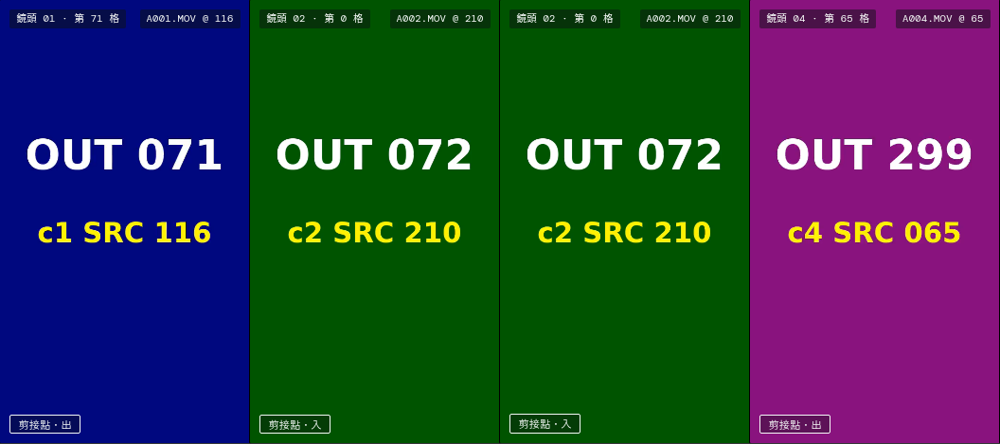
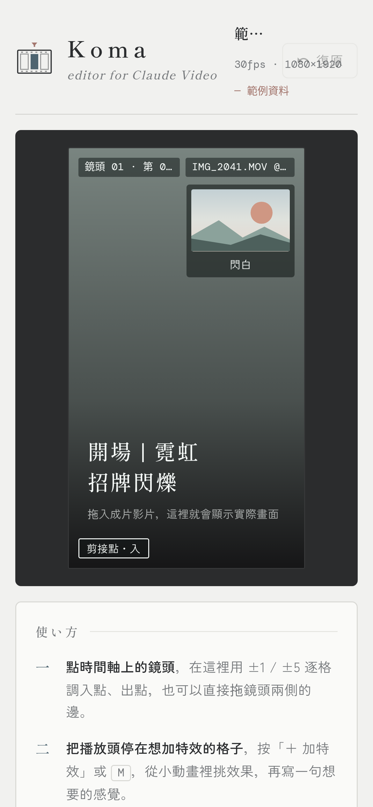
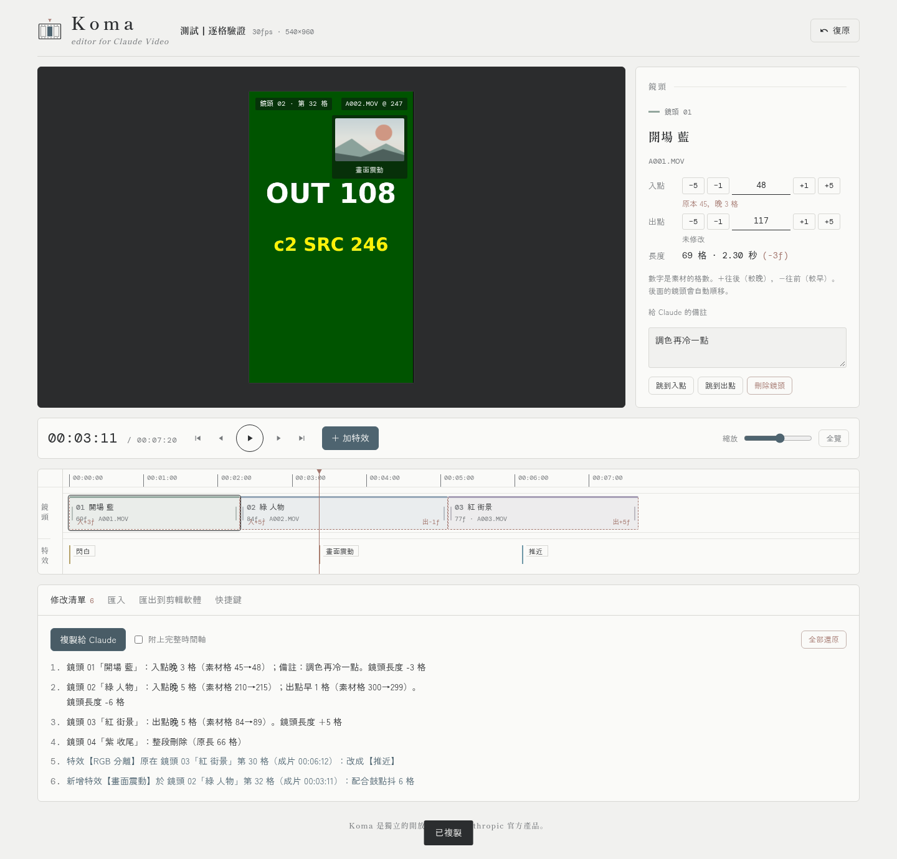

# AITABLE 圓桌 004｜Koma 影格 獨立審核（程式與自動化）

- 審核對象：https://bbcode1111.github.io/koma/ ，原始碼 BBCODE1111/koma `main` @ `e10781b`（2026-10-31 00:49 台北時間，唯一一個 commit）。線上版與 repo 的 `index.html` 逐位元組相同。
- 方式：唯讀。repo 只 clone 到 box 讀。實測用 headless Google Chrome 156 跑 Playwright，桌面 1440×900，手機用 iPhone UA 模擬 390×844 加觸控。用 ffmpeg 做了 10 秒 30fps 的測試影片，每格燒上「成片格號」和「素材格號」，搭配對應的 `.koma.json`。匯出檔用 lxml、Apple FCPXML 1.9 DTD（取自 CommandPost 收錄的版本）、OpenTimelineIO 0.18 的 FCPXML／CMX3600 adapter 驗證。
- 沒做的事：沒改檔、沒 push、沒開 issue／PR／留言，也沒對外發任何東西。
- **沒辦法測的**（以下相關結論都標「未驗證」）：
  - 真的 Final Cut Pro、DaVinci Resolve、Premiere、剪映匯入（box 上沒有這些軟體）
  - 實機 iPhone Safari（只用 Chrome 模擬）
  - claude.ai artifact 內的 `window.claude` 存檔路徑
  - HEVC 格式的 .mov
  - 真正由 Claude 產出的時間軸
  - GB 級的大影片

---

## 1. 五項分數（0–10）

| 項目 | 分數 | 一句理由 |
|---|---|---|
| 核心功能正確性 | **7** | 逐格對位、修剪、剪接點跳轉、特效標記、修改清單都實測正確（畫面燒錄格號完全對上）。但「載入範例」和開新連結會直接蓋掉唯一一份草稿，而且無法復原，屬於實測確認的資料遺失。 |
| 匯入匯出可靠性 | **5** | 30fps 下 Koma 自己匯出再匯入完全一致，EDL 結構也正確。但匯出的 FCPXML 標的是 1.9 版，卻用 1.8 的寫法，過不了 Apple DTD 驗證；29.97／23.976／59.94 還會寫出小數分子的時間值。拿去 Final Cut 很可能直接匯入失敗（實際匯入未驗證）。 |
| 易用性與介面（含手機） | **6** | 桌面版安靜清楚，三步驟引導、±1／±5、修改處虛線標示都好用。手機版標題列會跟「復原」重疊，時間軸放大後無法用手指左右滑動，介面還混著日文（「使い方」）。 |
| 產品定位（新手看得懂嗎、有解決真問題嗎） | **5** | 「把逐格修改翻成 Claude 看得懂的清單」是真問題，輸出品質也好。但前提是 Claude 能交出成片和 koma.json（要有能跑 ffmpeg 的 Claude 環境）。而 Alec 實際用的剪映，CapCut 官方說明不支援匯入其他剪輯軟體的工程，匯出這條路對目標使用者幾乎接不上。 |
| 程式碼與開源品質 | **5** | 單一 HTML 零依賴、MIT 授權、README 有完整格式規格和快捷鍵，這些是優點。但 935 行高密度單行程式、沒有任何測試、沒有 CI、沒有 lint，只有一個 commit，repo 沒寫說明，還夾帶 43KB 的舊原型。 |

**平均 5.6。**

---

## 2. 問題清單

### P0（壞掉或資料遺失）

**P0-1　「載入範例」直接蓋掉草稿，無法復原**（已實測）
- 位置：`index.html:809`（`#loadSample`）。`load()` 在 `index.html:441-446` 會清空 `undo=[]`，`save()` 在 `:447` 只寫入單一 key `koma:v1`（`:409`）。
- 重現：
  1. 載入自己的時間軸，做 4 項修改。
  2. 到「匯入」分頁按「載入範例」。
  3. 修改清單歸零，`undo.length=0`，localStorage 已經變成範例專案，重新整理也找不回來。
- 修法：
  - 有未匯出的修改時，先跳確認。
  - `load()` 前把目前的 `doc` 推進 undo，或先存一份備份。
  - 治本做法見 P0-2。

**P0-2　開啟另一個專案（`#koma=` 連結、拖入或貼上另一份時間軸）會覆蓋唯一的草稿**（連結路徑已實測，檔案和貼上是讀程式碼推論）
- 位置：`index.html:925-933`（開機時 hash 不一樣就直接 `load(h)`）、`:780-783`（`importText` 直接呼叫 `load`），以及 `KEY="koma:v1"` 只有單一欄位。
- 重現：
  1. 專案 A 改了 1 處。
  2. 新分頁開專案 B 的 `#koma=` 連結。
  3. 再開 Koma，看到的是 B，A 的修改沒了。
- 修法：
  - 草稿改用「專案 ID 或 orig 的雜湊」當 key，例如 `koma:v1:<hash>`，並保留最近 N 個專案的清單。
  - 切換專案前，提示要不要先匯出 JSON。

### P1（主要流程受阻）

**P1-1　FCPXML 宣告 1.9 版，結構卻是 1.8 寫法，過不了 DTD 驗證**（DTD 驗證已實測；Final Cut 實際匯入未驗證）
- 位置：`index.html:818-819`（`buildFCPXML`）。程式寫 `<fcpxml version="1.9">`，`<asset ... src="file:///...">` 卻沒有 `<media-rep>`。
- 重現：任何匯出的 .fcpxml 拿 FCPXMLv1_9.dtd 驗證，會出現：
  - `No declaration for attribute src of element asset`
  - `Element asset content does not follow the DTD, expecting (media-rep+ , metadata?)`
- 已驗證兩種修法都能通過：
  - 改用 `<asset ...><media-rep kind="original-media" src="..."/></asset>`，用 1.9 DTD 驗證通過（修正示範檔留在審核者的 box，未納入 repo）。
  - 或把版本改成 `version="1.8"`，那就只剩版本字串不符，結構相容。
- 建議用 media-rep 的寫法，並在 CI 加上 DTD 驗證。

**P1-2　29.97／23.976／59.94 匯出的 asset duration 分子是小數**（已實測）
- 位置：`index.html:819`，`duration="${T(a.max+fps*2)}"`。`fps*2` 是 59.94 這類小數，所以會寫出 `177116.94/30000s`。
- DTD 註明時間值必須是「64-bit 整數分子／32-bit 分母」。這點 DTD 抓不到，但不合規格。
- 重現：載入 `fps:29.97` 的時間軸，匯出 FCPXML。
- 修法：改成 `T(a.max+Math.round(fps)*2)`，並對所有 `T()` 的輸入做 `Math.round`。

**P1-3　「素材格數」的單位沒定義清楚，FCPXML 也假設素材從 0 秒開始**（未驗證，屬規格風險）
- 位置：README 的時間軸格式說明、`index.html:813-822`（`start="${T(c.in)}"`，asset 寫 `start="0s"`）。
- 問題：
  - `in`/`out` 是用成片 fps 計算，不是素材本身的 fps。手機拍的 60fps 素材放進 30fps 成片時，如果 Claude 寫的是素材自己的格號，匯出的入出點會差兩倍。
  - 有內嵌起始時間碼的攝影機或手機檔，在 FCP 裡 asset 的 start 不是 0，這時 asset-clip 的 start 可能落在素材範圍外。
- 修法：
  - 格式明訂「in/out 以成片 fps 計的素材時間」，或改用秒數或有理數。
  - 加上選填的 `srcFps`、`srcStart`、`srcDuration` 欄位，匯出時一併使用。

### P2（應改善）

1. **極端輸入會讓整頁卡死**（已實測）
   - 位置：`renderTimeline`，`index.html:476-479`。
   - 重現：貼上 `{"clips":[{"in":0,"out":1000000000}]}`，頁面超過 15 秒沒有回應（刻度的迴圈會產生上百萬個 DOM 節點）。
   - 修法：`normalize` 限制總長度（例如小於 2 小時），刻度數量也設上限。
2. **影片串流起始時間不是 0 時，預覽會差一格**（已實測）
   - 我第一支測試片用 ffmpeg concat 加 AAC，影像串流 start_time 是 0.021 秒。Koma 用 `(of+.5)/fps` 去 seek，所有位置都顯示「前一格」。重做成 start 0 的片後就完全正確。
   - Claude 用 ffmpeg 產片時很可能遇到同樣情況。
   - 位置：`updatePreview`，`index.html:513`。
   - 修法：用 `requestVideoFrameCallback` 的 `mediaTime` 去校正，或讓使用者在第 0 格做一次偏移校準。
3. **手機版時間軸放大後無法滑動**（已實測）
   - 位置：`.clip`/`.ruler` 都設了 `touch-action:none`，`#trV`/`#trF` 的 pointerdown 會變成拖曳播放頭（`index.html:175-187, 627-651`）。
   - 重現：390 寬、`ppf=6` 時，在鏡頭上或特效軌上左右滑，`scrollLeft` 一直是 0，只有播放頭在動。
   - 現在只能按「全覽」，配合 ±1 按鈕繞過。全覽時每格只有 0.75px，手指拖 30px 就是 40 格。
   - 修法：加上兩指平移或專用捲動列，或在手機上把「拖曳＝捲動」、「長按＝拖播放頭／修剪」分開。
4. **手機標題列重疊**（已實測，見 [m01_mobile_first.png](aitable-004-shots/m01_mobile_first.png)）
   - 專案名被截成「範…」，「30fps · 1080×1920」跟「復原」按鈕疊在一起。
   - 位置：`.top`/`.proj`，`index.html:33-39`。
   - 修法：560px 以下讓 `.proj` 換到第二行。
5. **繁中介面混入日文，字型也是日文字型**（已實測）
   - 右側引導標題寫「使い方」（`:550`），特效縮圖寫「夜の街」（`:460`）。主字型是 Zen Kaku Gothic New 和 Shippori Mincho，`<html>` 也沒有 `lang`。
   - 修法：改成「使用方式」；設 `lang="zh-Hant-TW"`；字型改用 Noto Sans TC／Noto Serif TC，或直接用系統字型。
6. **同一個分頁換 `#koma=` 連結不會載入**（已實測）
   - 程式沒有監聽 `hashchange`（`:917-933`）。
   - 修法：加上 `hashchange` 監聽，並配合 P0-2 的提示。
7. **修改清單沒附鏡頭 id 和素材檔名**（已實測）
   - 預設不勾「附上完整時間軸」時，Claude 只能靠順序和名稱去對應鏡頭（`changes()`，`:557-581`）。
   - 修法：每行加上 `[c2 / A002.MOV]`，或預設勾選附上 JSON。
8. **給 Claude 的指令要它手動做 raw deflate 加 base64url**（未驗證）
   - 沒有程式執行環境的 Claude 很可能算錯，結果就是「連結裡的時間軸無法讀取」（`:908-909`）。
   - 修法：指令改成「附 .koma.json 檔即可」，連結當選配，並改用不壓縮的 `#koma=j`（程式已經支援）。
9. **鏡頭可以無限延長**（已實測）
   - `out` 沒有上限（`:600, 635`），提示詞會要求 Claude 用不存在的素材格。
   - 修法：格式加上 `srcDuration`，延長超過時警告。
10. **無效的 fps 會默默改成 30**（已實測）
    - `"fps":-5` 和 `"fps":"abc"` 都顯示「已載入」（`normalize`，`:427`）。
    - 修法：顯示警告，並列出改用的值。
11. **復原不完整**（已實測）
    - 備註輸入框的修改不進 undo（`:534, 548`），也沒有重做。
    - 修法：備註失焦時推一次 undo，並加上 Ctrl+Shift+Z。
12. **重新整理後影片消失，也沒有提示**（已實測；截圖未納入 repo）
    - 草稿還在，但要重拖影片，畫面上沒說明。
    - 修法：草稿還原時顯示「請重新拖入成片影片」。
13. **EDL 的相容性疑慮**（未驗證）
    - TITLE、FROM CLIP NAME、LOC 都直接寫 UTF-8 中文。CMX3600 傳統上只用 ASCII，Premiere／Resolve 讀進來會不會亂碼沒驗證。
    - 50／60fps 的 EDL 不是每套軟體都吃。OTIO 解析 24／25／29.97／23.976／59.94／60 都成功，格號也一致。
    - 修法：提供「ASCII 安全」選項，把中文轉進 COMMENT 或改用拼音檔名。
14. **FCPXML 的小細節**（讀程式碼得知）
    - png 字卡也寫成 `hasAudio="1"`。
    - 沒填素材資料夾時，src 是 `file:///IMG_2041.MOV`（根目錄的假路徑）。
    - asset duration 用「最大 out 加 2 秒」去猜。
    - 修法：沒填資料夾時改用相對路徑或省略 src；依副檔名判斷有沒有聲音。
15. **觸控目標偏小**（已實測）
    - 傳輸列按鈕 36×36、±按鈕 36 寬、修剪把手只有 9px，都低於 44px 建議值。
16. **開源基本功不足**（已實測）
    - 沒有測試、沒有 CI（例如 Pages 部署前跑 Playwright 加 DTD 驗證）、沒有 lint，只有一個 commit。
    - repo 的 description 和 topics 都是空的；`archive/cutdesk-prototype.html` 跟產品無關卻放在根目錄；依賴 Google Fonts。
    - 另有 favicon 404，不影響功能。

### 實測確認「沒問題」的部分（供對照）
- **格位對應**：0、1、71、72、161、162、299 格的畫面、素材格和時間碼全部一致。修剪 c2 入點 +5 之後，同一個位置正確顯示素材 215 格；c1 出點 −10 之後，播放跨過剪接點會正確跳到下一顆鏡頭。
- **播放**：影片大約落後播放頭 1–1.5 格，暫停時精準。
- **快捷鍵**：←→、Shift 一次 5 格、↓ 跳剪接點、M、Ctrl+Z 都正確。拖曳把手 3 格就是入點 +3。
- **修改清單**：繁中、具體（「入點晚 5 格（素材格 210→215）」、「整段刪除」、「改成【推近】」、「新增特效…第 32 格（成片 00:03:11）」），複製到剪貼簿的內容一致。
- **往返一致**：30fps 下 FCPXML、EDL 往返，鏡頭、特效、名稱、素材檔名完全一致。各 fps 的 EDL 往返也一致。
- **壞輸入**：亂碼、壞 JSON、沒有 clips、out<in、壞 XML、Premiere 的 xmeml，都有清楚的中文錯誤訊息。
- **大型時間軸**：3000 顆鏡頭加 800 個特效，載入 155ms，單次微調 134ms，localStorage 用掉約 0.56MB，可以用。
- **控制台**：除了 favicon 404，沒有其他錯誤或 pageerror。

---

## 3. 新點子（最多三個）

1. **剪映路線改成「手動操作清單」，不要靠工程匯入。**
   - CapCut 官方說明（2026-01-21）寫明目前不支援匯入或匯出第三方剪輯軟體的工程檔：https://www.capcut.com/help/how-to-export-pro-project
   - 中國版剪映專業版的「導入工程」能不能吃 FCPXML 或 prproj，**官方文件查不到**。只有第三方文章說有，例如 https://mydown.yesky.com/news/343713.html ，而且說法不一。EDL 匯入**查不到**可靠來源。
   - 所以要先確認 Alec 用的是 CapCut 還是中國版剪映專業版。在那之前，最實際的做法是讓 Koma 多輸出一份「剪映操作清單」：每顆鏡頭在成片的「時:分:秒:格」、要往哪邊修幾格、在哪一格加什麼效果，照著逐項做就行。
2. **多專案草稿加「備份成 JSON」。** 這樣 P0 一併解決，也讓「下次再用 Koma 打開」真的可靠。
3. **每一條修改附上那一格的截圖。** 用 canvas 抓 `video` 的當前畫面，複製時連同圖片一起給 Claude，看圖比看格號更不容易誤解。需要確認 claude.ai 貼上多張圖片的體驗，未驗證。

---

## 4. 分工意見

大致同意，有三點要直說：
- **格式相容不能只靠 AI 讀程式碼。** 這次 FCPXML 的問題就是「看起來對、DTD 不過」。建議 Codex 負責修，驗證則分兩層：
  - 我把這次的 Playwright、DTD、OTIO 檢查做成可以重跑的腳本，接進 CI。
  - 每輪由 Alec（或 Claude 用他的 Mac）實際拿 FCP 或 Resolve 匯入一次，5 分鐘就夠。沒有真實匯入，「匯入匯出可靠性」的分數就封頂 7。
- **Claude 同時實作又驗證，等於自己改自己的考卷。** 建議實作的人（Claude 或 Codex）跟驗證的人分開，回歸測試由我跑，結果附截圖和數據。
- 我負責使用者觀點和定位沒問題。但剪映能不能匯入這件事需要 Alec 本人確認版本，其他人都查不到官方答案。

---

## 5. 收斂標準意見

「五項平均 ≥ 8.5、沒有 P0／P1、最多 3 輪」的方向可以，但有兩點建議調整：
- **主觀分數不該當主要門檻。** 改成客觀條件加上分數下限：
  - 沒有 P0／P1。
  - 自動檢查全過：FCPXML 通過 DTD、30／29.97／24／60fps 往返一致、桌面和手機的 Playwright 流程。
  - Alec 實際在一套 NLE（FCP 或 Resolve）匯入成功一次。
  - 分數上，每項 ≥ 7、平均 ≥ 8。
- **8.5 對這種單檔 v1 工具偏高。** 以目前 5.6 來看，3 輪內要到 8.5，多半得靠評審手軟或灌水。
- **3 輪上限同意。** 第 3 輪還沒收斂的話，砍範圍（例如先拿掉 EDL，或把手機版標成「僅供瀏覽」），不要開第 4 輪。

---

### 附：證據截圖

**逐格對位正確**：畫面燒錄的成片格號、素材格號與 Koma 顯示一致，含 c1 出點 −10 後跨剪接點。

**手機版（390×844）首屏**：專案名被截斷、fps／尺寸與「復原」按鈕重疊，引導標題為日文「使い方」。

**桌面版修改清單**：修剪、刪除鏡頭、改特效、新增特效後產生的繁中提示詞。

測試腳本、測試影片、匯出樣本和原始數據留在審核者的 box（`/workspace/koma-review/`），沒有放進 repo。
